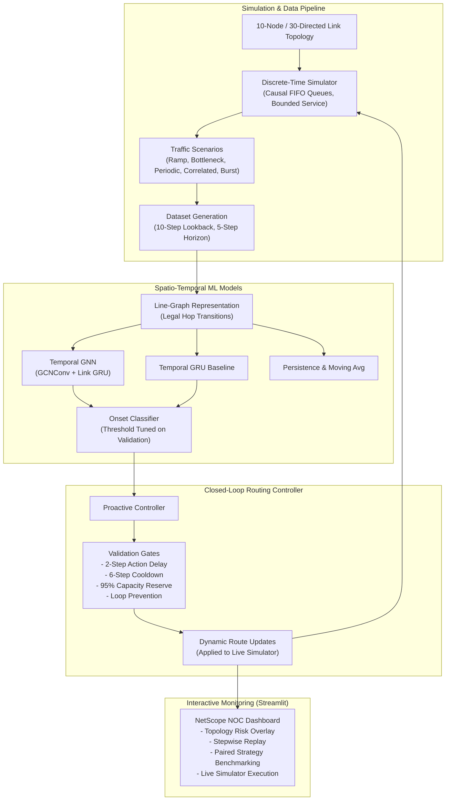

# Graph Neural Network-Based Network Congestion Prediction

[](https://www.python.org/downloads/)
[](https://pytorch.org/)
[](https://pyg.org/)
[](https://streamlit.io/)
[](LICENSE)
[](tests/)

An end-to-end research and experimentation platform investigating **spatio-temporal Graph Neural Networks (GNNs)** and **Gated Recurrent Units (GRUs)** for predicting network link congestion and evaluating **proactive closed-loop traffic rerouting** in simulated communication networks.

---

> [!IMPORTANT]
> **Scientific & Academic Framing**: This project evaluates machine learning models within a controlled, discrete-time network simulator. All metrics (utilization, queue delay, packet loss rate, and delivery ratio) are simulated hop-level measurements and proxies rather than end-to-end packet-level traces from physical hardware. Proactive routing is evaluated under strict closed-loop constraints to assess whether ML predictions provide actionable lead time before congestion events occur.

---

## Table of Contents

- [Overview](#overview)
- [System Architecture](#system-architecture)
- [Project Structure](#project-structure)
- [Installation & Setup](#installation--setup)
- [Research Phases](#research-phases)
  - [Phase 1: Deterministic Network Simulator](#phase-1-deterministic-network-simulator)
  - [Phase 1.5: Multi-Seed Traffic Calibration](#phase-15-multi-seed-traffic-calibration)
  - [Phase 2: Spatio-Temporal Dataset Generation](#phase-2-spatio-temporal-dataset-generation)
  - [Phase 3: Temporal GNN & Baseline Model Training](#phase-3-temporal-gnn--baseline-model-training)
  - [Phase 3.5: Fresh-Seed Diagnostics & Horizon Analysis](#phase-35-fresh-seed-diagnostics--horizon-analysis)
  - [Phase 3.6: Congestion Onset Classification](#phase-36-congestion-onset-classification)
  - [Phase 4: Closed-Loop Proactive Traffic Management](#phase-4-closed-loop-proactive-traffic-management)
  - [Phase 5: Interactive NOC Monitoring Dashboard](#phase-5-interactive-noc-monitoring-dashboard)
- [Experimental Results & Key Findings](#experimental-results--key-findings)
- [Interactive Dashboard](#interactive-dashboard)
- [Automated Testing & Verification](#automated-testing--verification)
- [Academic Context & Presentation Slides](#academic-context--presentation-slides)
- [Limitations & Methodological Notes](#limitations--methodological-notes)

---

## Overview

Modern IP networks experience transient congestion due to dynamic, bursty traffic. Traditional routing protocols (e.g., static Dijkstra, OSPF) react only after packet drops or buffer overruns have occurred. This project explores whether graph-structured deep learning can anticipate link congestion before buffers fill up, enabling proactive traffic rerouting.

### Key Highlights

- **Directional Line Graph Topology**: Models 10 routers and 15 physical full-duplex links as a 30-node directed graph where each directed link represents a graph node with independent FIFO queues.
- **Spatio-Temporal GNN Architecture**: Couples 2-layer directed `GCNConv` message passing (PyTorch Geometric) over valid hop transitions with temporal `GRU` sequence encoders.
- **Dedicated Onset Event Modeling**: Formulates congestion prediction as an early-onset classification task (anticipating first $\ge 85\%$ utilization crossings within a 5-step horizon) rather than naive point regression.
- **Realistic Closed-Loop Controller**: Simulates operational deployment constraints including a 2-step decision delay, 6-step link cooldown, loop prevention, and a 95% capacity reserve check.
- **Interactive NOC Dashboard**: Streamlit-based operations center providing step-by-step playback, real-time risk overlays, live simulation execution, and paired strategy comparisons.

---

## System Architecture



---

## Project Structure

```
gnn-network-congestion/
├── .streamlit/
│   └── config.toml                  # Streamlit theme and headless server configuration
├── dashboard/
│   └── app.py                       # Streamlit NOC Dashboard (NetScope)
├── presentation/
│   ├── gnn_network_congestion_presentation.pptx       # Presentation deck draft
│   └── gnn_network_congestion_presentation_final.pptx # Final presentation slide deck
├── scripts/
│   ├── simulate.py                  # Single-run simulator entrypoint
│   ├── calibrate_traffic.py         # Multi-seed traffic calibration
│   ├── generate_dataset.py          # Phase 2 dataset generation
│   ├── train_models.py              # Phase 3 temporal GNN/GRU regression training
│   ├── evaluate_models.py           # Phase 3 model evaluation and plotting
│   ├── phase35_experiment.py        # Phase 3.5 multi-horizon diagnostic experiment
│   ├── train_onset.py               # Phase 3.6 onset classification experiment
│   └── phase4_experiment.py         # Phase 4 closed-loop routing experiment
├── src/
│   └── congestion_sim/
│       ├── __init__.py
│       ├── topology.py              # NetworkX topology and directional line graph
│       ├── simulator.py             # Discrete-time queueing network simulator
│       ├── dataset.py               # Spatio-temporal rolling window dataset builders
│       ├── models.py                # PyG GNN, GRU, and baseline neural models
│       ├── training.py              # Training loops, loss functions, and evaluation metrics
│       ├── onset.py                 # Causal onset features, scenarios, and episode metrics
│       ├── routing.py               # Closed-loop routing controller and routing strategies
│       └── dashboard_data.py        # Dashboard data loaders, filters, and aggregators
├── tests/
│   ├── test_simulator.py            # Unit tests for topology and queue simulation
│   ├── test_models.py               # Unit tests for GNN/GRU models and gradients
│   ├── test_onset.py                # Unit tests for scenarios and onset episode metrics
│   ├── test_routing.py              # Unit tests for routing controller and loop prevention
│   └── test_dashboard_data.py       # Unit tests for dashboard data loading and transforms
├── DEMO_GUIDE.md                    # Step-by-step walkthrough script for project demo
├── requirements.txt                 # Pinned project dependencies
├── .gitignore                       # Clean Git configuration excluding caches, venvs & artifacts
└── README.md                        # Project documentation (this file)
```

---

## Installation & Setup

### Prerequisites

- **Python**: 3.11 or newer (Python 3.11 and 3.12 recommended; compatible with Apple Silicon MPS, CUDA, and CPU).
- **Git**: For version control.

### Quick Start

```bash
# Clone the repository
git clone https://github.com/navyaaggarwal29/gnn-network-congestion-prediction.git
cd gnn-network-congestion-prediction

# Create and activate a virtual environment
python3 -m venv .venv
source .venv/bin/activate

# Install required dependencies
python -m pip install --upgrade pip
python -m pip install -r requirements.txt
```

---

## Research Phases

### Phase 1: Deterministic Network Simulator

A custom discrete-event simulator modeling packet traffic across a 10-node, 15-link topology (30 directed links). Traffic is quantized into 1,200-byte packets serviced within 1-second intervals. Each direction maintains an independent 252,000-byte FIFO queue (~210 packets).

Run a 60-step burst simulation:
```bash
python scripts/simulate.py --steps 60 --seed 7 --profile burst --output data/phase1_measurements.csv
```
Available profiles: `normal` (40 Mbps), `moderate` (80 Mbps), `burst` (40 Mbps with 4x burst at step 20), and `sustained_high` (160 Mbps).

### Phase 1.5: Multi-Seed Traffic Calibration

Calibrates loss, latency, and queue occupancy across multiple seeds to establish baseline saturation thresholds:
```bash
python scripts/calibrate_traffic.py --seeds 10 --steps 80 --output-dir results/phase1_5
```

### Phase 2: Spatio-Temporal Dataset Generation

Generates rolling temporal windows over directional line graphs (linking valid consecutive directed links at routers, excluding immediate U-turns):
```bash
python scripts/generate_dataset.py --seeds 20 --steps 60 --window 10 --horizon 5 --output-dir data/generated/phase2
```
Outputs compressed NPZ files (`train.npz`, `validation.npz`, `test.npz`) containing input tensor $x \in \mathbb{R}^{\text{samples} \times 10 \times \text{features} \times 30}$ and label tensor $y \in \mathbb{R}^{\text{samples} \times 5 \times 30}$. Normalization statistics are strictly fit on training splits only.

### Phase 3: Temporal GNN & Baseline Model Training

Trains spatio-temporal GNNs (2-layer directed `GCNConv` + link-level GRU) alongside standard GRU and heuristic baselines:
```bash
python scripts/train_models.py --data-dir data/generated/phase2 --output-dir results/phase3 \
    --batch-size 32 --epochs 60 --learning-rate 0.001 --hidden-dim 64 --dropout 0.2 \
    --patience 8 --seed 42 --device auto

python scripts/evaluate_models.py --data-dir data/generated/phase2 --experiment-dir results/phase3 --device auto
```

### Phase 3.5: Fresh-Seed Diagnostics & Horizon Analysis

Evaluates model generalization across held-out seed groups (1000–1029) and multiple forecast horizons (1, 3, and 5 steps):
```bash
python scripts/phase35_experiment.py --seeds 30 --seed-start 1000 --steps 60 --epochs 12 --out results/phase3_5 --device auto
```

### Phase 3.6: Congestion Onset Classification

Reframes the problem from continuous utilization regression to **event-based onset classification**. An onset event is defined as the first crossing into $\ge 85\%$ utilization within the 5-step horizon, conditional on the link currently being uncongested.

```bash
python scripts/train_onset.py --seeds 25 --seed-start 2000 --steps 80 --window 10 --horizon 5 \
    --epochs 16 --hidden 24 --decision-delay 2 --out results/phase3_6 --device cpu
```

Evaluates across 5 distinct traffic scenarios:
1. `gradual_ramp`: Linearly increasing background load.
2. `sustained_bottleneck`: Constant high-volume flows saturating specific bottlenecks.
3. `periodic`: Sinusoidal oscillating background traffic.
4. `correlated`: Autoregressive AR(1) demand patterns.
5. `sudden_burst`: Unannounced 4-step sudden traffic spikes.

### Phase 4: Closed-Loop Proactive Traffic Management

Evaluates closed-loop routing performance comparing:
- **Static Dijkstra**: Baseline shortest-propagation-path routing.
- **Reactive Routing**: Reroutes when link utilization exceeds 85%.
- **GRU Onset Proactive**: Uses GRU onset predictions to reroute before congestion.
- **GNN Onset Proactive**: Uses spatio-temporal GNN onset predictions to reroute.

Run the pilot check:
```bash
PYTHONPATH=src MPLCONFIGDIR=/tmp/gnn_mpl python scripts/phase4_experiment.py --mode pilot --steps 80
```

Run the frozen 5-seed paired evaluation:
```bash
PYTHONPATH=src MPLCONFIGDIR=/tmp/gnn_mpl python scripts/phase4_experiment.py --mode final --steps 80 --seeds 5
```

---

## Experimental Results & Key Findings

### Phase 3.6 Held-Out Onset Classification Metrics

Evaluated on held-out test seeds (seeds 2020–2024, 40 eligible onset episodes):

| Model | Threshold | Precision | Recall | F1 Score | PR-AUC | Mean Lead Steps | False Alerts / Run |
| :--- | :---: | :---: | :---: | :---: | :---: | :---: | :---: |
| **GRU Onset** | 0.9972 | **1.0000** | 0.2750 | **0.4314** | **0.6653** | **3.27 steps** | **0.00** |
| **GNN Onset** | 0.9643 | 0.2973 | 0.2750 | 0.2857 | 0.4704 | 3.18 steps | 1.73 |
| **Persistence** | 0.9000 | 0.0000 | 0.0000 | 0.0000 | 0.2319 | — | 0.00 |
| **Moving Avg** | 0.9999 | 0.0000 | 0.0000 | 0.0000 | 0.1832 | — | 0.00 |

*Key finding: The non-graph GRU achieved superior precision and zero false alerts compared to the GNN onset model, demonstrating that local temporal queue history provided cleaner onset signals than broader line-graph spatial aggregation on this topology.*

### Phase 4 Closed-Loop Routing Comparison

Mean improvements over paired Static Dijkstra baseline across 5 seeds:

| Scenario | Strategy | Mean Delay Impv (%) | Packet Loss Impv (%) | Congestion Duration Impv (%) |
| :--- | :--- | :---: | :---: | :---: |
| **Periodic** | **Reactive** | **+9.72%** | **+69.32%** | **+48.84%** |
| | GRU Proactive | +5.27% | +53.91% | +27.27% |
| | GNN Proactive | +3.10% | +41.45% | +13.65% |
| **Gradual Ramp** | **Reactive** | **+13.90%** | **+96.79%** | **+54.07%** |
| | GRU Proactive | +11.97% | +95.55% | +22.15% |
| | GNN Proactive | +1.22% | +43.09% | 0.00% |
| **Correlated** | **Reactive** | **+2.34%** | **+75.47%** | **+54.31%** |
| | GRU Proactive | +1.99% | +52.80% | +36.19% |
| | GNN Proactive | +0.99% | +37.46% | +20.02% |
| **Sustained Bottleneck** | **Reactive** | **+9.48%** | **+89.94%** | 0.00% |
| | GRU Proactive | +5.00% | +84.72% | 0.00% |
| | GNN Proactive | 0.00% | 0.00% | 0.00% |
| **Sudden Burst** | Reactive | -0.11% | +27.83% | 0.00% |
| | GRU Proactive | 0.00% | 0.00% | 0.00% |
| | GNN Proactive | 0.00% | 0.00% | 0.00% |

*Takeaway: Reactive threshold routing demonstrated the most robust overall mitigation. While proactive ML models delivered meaningful improvements in periodic and gradual scenarios, sudden unannounced bursts remain unpredictable without prior signaling.*

---

## Interactive Dashboard

The NetScope Network Operations Center (NOC) dashboard provides an intuitive, web-based control room to visualize network states, explore risk predictions, and run live simulations.

### Launching the Dashboard

```bash
# Launch via Streamlit
python -m streamlit run dashboard/app.py
```

If the default port `8501` is busy:
```bash
python -m streamlit run dashboard/app.py --server.port 8502
```

### Dashboard Modules

1. **Live Monitor & Playback**: Step through recorded simulation steps, inspect directional link metrics (utilization, queue size, dropped bytes), and view model risk indicators.
2. **Live Simulation Engine**: Run a fresh 80-step simulation on demand using any scenario, seed, and controller strategy.
3. **Routing Comparison**: Side-by-side benchmarking of Static Dijkstra, Reactive, GRU, and GNN routing policies across all simulated scenarios.
4. **Model Performance**: Deep-dive into precision-recall curves, detection timelines, lead times, and episode metrics.
5. **Interactive Demo Walkthrough**: Built-in guide walking through the periodic load scenario (see [DEMO_GUIDE.md](DEMO_GUIDE.md) for full script).

---

## Automated Testing & Verification

The project includes an automated test suite verifying simulator dynamics, queue bounds, line-graph connectivity, model backprop, and controller logic:

```bash
# Run tests using unittest
PYTHONPATH=src python3 -m unittest discover -s tests -v

# Or run tests using pytest
PYTHONPATH=src pytest
```

### Test Coverage Highlights

- `tests/test_simulator.py`: Topology validation, queue drops under extreme load, Dijkstra routing, line graph edge validity.
- `tests/test_models.py`: PyG graph batching, GCNConv directional message passing, checkpoint serialization, parameter dimension checks.
- `tests/test_onset.py`: Causal feature verification, scenario reproducibility, overlapping episode deduplication.
- `tests/test_routing.py`: Decision delay compliance, link cooldown enforcement, loop prevention, flow conservation.
- `tests/test_dashboard_data.py`: Replay determinism, metrics loader error handling, missing artifact tolerance.

---

## Academic Context & Presentation Slides

This repository forms an academic research project studying machine learning applications in computer networks. 

- **Presentation Slide Deck**: Located in [`presentation/gnn_network_congestion_presentation_final.pptx`](presentation/gnn_network_congestion_presentation_final.pptx) and [`presentation/gnn_network_congestion_presentation.pptx`](presentation/gnn_network_congestion_presentation.pptx).
- **Demo Script**: Step-by-step instructions for demonstrating the live dashboard are detailed in [`DEMO_GUIDE.md`](DEMO_GUIDE.md).

---

## Limitations & Methodological Notes

1. **Hop-Level Measurements**: The simulator computes interval-level queue delay and hop-by-hop packet transfers without tracking individual packet GUIDs end-to-end. Packet delivery ratio and loss rate are hop-level proxies.
2. **Closed-Loop Feedback**: Models were trained offline under static Dijkstra routing. In closed-loop operation, rerouting decisions alter traffic distributions, inducing distribution shift.
3. **Topology Scale**: Experiments are conducted on a canonical 10-node, 15-physical-link topology. Larger transit or fat-tree topologies may exhibit different spatial scaling properties.
4. **Simulated Environment**: All data is synthetically generated via discrete-event simulation; no physical router telemetry or live internet traffic was captured.

---

## License

This project is licensed under the MIT License — see the [LICENSE](LICENSE) file for details.
